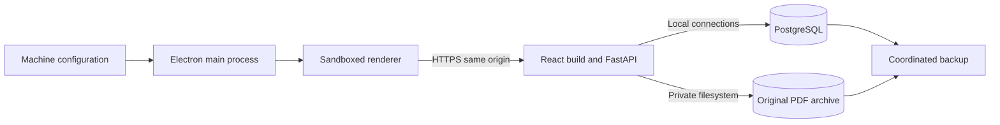

# Rollcall desktop proof decisions

November 20, 2026

The first implementation is a single-PC proof with synthetic data. The edited design plan governs the later LAN rehearsal and shop pilot. This proof uses the server-served React build because the existing app already uses relative API URLs and documents reopen on the same origin.

| Decision | Default and failure behavior | Owner and acceptance |
|---|---|---|
| Client/server | Electron opens one HTTPS origin from a JSON file in ProgramData. Invalid or missing configuration prompts the user to contact the administrator. A local Retry/Close dialog handles initial connection and certificate failures. The existing original-PDF link can open one narrowly scoped, sandboxed child window per click. | Deployment administrator writes and ACL-protects configuration. Verify a regular account can read it and cannot edit it. Verify redirects and popups outside the configured origin are blocked. |
| TLS and network | Use normal OS trust and name validation. The prototype listener binds loopback. LAN deployment needs a stable DNS name, trusted certificate and an approved firewall scope. | Home administrator provisions test trust on both PCs. Shop IT confirms DNS, certificate issuer, renewal ownership and permitted addresses. Verify valid and invalid certificates and private service ports. |
| Identity | The existing document API has no staff authentication. Loopback proof uses a synthetic database and archive. Named staff sessions, server-side roles, CSRF checks and write attribution are required before using real records. | Product owner and shop IT confirm staff and admin account provisioning and expiry. Verify signed-out and insufficient-role denial and attributed writes. |
| PDF | Reuse raw upload, stored original and correction routes. The backend currently caps body size at 10 MiB and stores originals outside the web root under generated identifiers. Production parsing needs a bounded worker, and serving originals needs authorization. | Backend owner proves rejected uploads leave consistent state, originals reopen byte-for-byte and archive access is authorized. |
| Release and restore | Version client and server together for the rehearsal. Shop release requires signed installer, separate migration and runtime privileges where practical, coordinated encrypted backups, and a documented restore. | Shop IT confirms service identity, startup, signing, backup retention and recovery objectives. Verify install, upgrade, rollback and isolated restore. |



## Source inventory and trust boundaries

- `frontend/src/App.jsx` and `DocumentReview.jsx` use live health and PDF API routes. Dashboard counts are placeholders. `docs/rollcall/interaction-preview.html` and its preview modules contain fictional inventory, reports and corrections for the visual reference.
- `backend/app/documents.py` accepts PDF bytes and serves originals. `document_parser.py` extracts text in-process. `document_store.py` uses PostgreSQL for metadata and corrections and a separate filesystem archive for immutable bytes. The API currently exposes its document routes without user identity. The production access gate must cover list, detail, upload, save and original routes.
- Client configuration or deployment access controls which code Electron receives. Use administrator-owned machine configuration and restrict server deployment writers. Verify the configured HTTPS origin and the trust store on each workstation. Keep renderer privileges disabled and constrain in-window navigation, redirects and permissions.
- PDF input crosses a parser boundary. The existing upload ceiling limits request size. Processing time and memory remain a pilot concern. Verify a bounded worker and consistent results with synthetic rejected and valid inputs before enabling shop uploads.
- Database rows and PDF bytes form one recovery set. Verify restore against a separate instance with matching hashes and reopened originals. The isolated restart test establishes durability across a test database restart.

## Proof sequence

1. Run the frontend tests and build, then run the full backend verifier against its disposable PostgreSQL cluster.
2. Use `desktop/policy.cjs` tests to validate HTTPS origin acceptance and rejection before wiring Electron. Keep the browser window sandboxed and handle failures with an Electron dialog.
3. Use `backend/serve_desktop_proof.py` to serve the production build and existing API over a single loopback TLS listener. Verify the frontend loads, API routes retain JSON errors, and certificate validation fails closed.
4. Move to LAN packaging and backed inventory after the local proof. The laptop, scoped network rules, installer signature and restore rehearsal each require their own evidence.

References: [Electron security guidance](https://www.electronjs.org/docs/latest/tutorial/security), [Electron code signing](https://www.electronjs.org/docs/latest/tutorial/code-signing), [Electron 45.4.1 release](https://releases.electronjs.org/release/v45.4.1).

## Verification on the development PC

| Check | Observed result |
|---|---|
| `pnpm.cmd test` and `pnpm.cmd build` in `frontend` | 9 tests passed. HeroUI import audit and Vite production build passed. Two CSS optimizer warnings concerned HeroUI-generated `@property` rules. |
| `backend/.venv/Scripts/python.exe -m pip install -r backend/requirements-lock.txt`, then `-m pip check` | The first attempt failed to resolve the package index from the sandbox. An approved tool invocation installed the unchanged lock file. Dependency consistency passed. |
| `backend/.venv/Scripts/python.exe backend/verify_isolated_database.py` | 24 tests passed, including the same-origin route check and real PostgreSQL integration. The synthetic original, corrected fields, review history and revision reopened after restart. The temporary PostgreSQL cluster was stopped. The suite reported one Starlette/AnyIO deprecation warning. [Verifier result](../../output/isolated-postgres/run-651427a354f7/evidence.json) |
| `node --test desktop/policy.test.cjs` and `node --check desktop/main.cjs` | Four policy tests passed. The Electron entry point passed the syntax check. |
| Electron 45.4.1 Windows x64 runtime and loopback TLS | The ZIP matched the upstream checksum. Using a fixture-specific trust decision in the test harness, Electron loaded the React build and same-origin health API. The renderer exposed neither Node require nor process. External navigation and popup attempts were blocked. A synthetic original opened in Chromium’s built-in PDF viewer in a sandboxed child window. With default certificate checks, the untrusted certificate and offline cases both reached Retry and Close. |

Runtime versions used were Node 24.22.3, Vite 6.4.1, Python 3.12.14, FastAPI 0.115.12, psycopg 3.2.9, pypdf 6.21.4, PostgreSQL 18.6 and Electron 45.4.1. The repository lock files contain the full frontend and Python version sets.

## Running the loopback proof

Build `frontend/dist` with `pnpm.cmd build` from `frontend`. From the workspace root, point `ROLLCALL_PROOF_DATABASE_URL` at an explicitly provisioned disposable database on a loopback IP. Use the existing document migration with that same database and provide a fresh synthetic archive directory. Use a trusted certificate and matching key for the configured local hostname.

```powershell
backend/.venv/Scripts/python.exe backend/serve_desktop_proof.py --certificate path/to/server.pem --key path/to/server-key.pem --archive path/to/synthetic-archive
```

For an unpackaged development launch, point `ROLLCALL_PROOF_CONFIG` at an absolute path to a JSON file containing `{"origin":"https://localhost:8443"}`. From the workspace root run `electron.exe desktop` with the pinned runtime. A packaged client reads `%ProgramData%\Rollcall\server.json`. The positive smoke fixture scoped trust to the harness process. The desktop application uses Electron’s default certificate validation.

## Windows rehearsal package

The versioned Windows x64 ZIP contains the Rollcall client, Electron 45.4.1 and a per-user PowerShell installer. Build it using the upstream Electron Windows x64 ZIP. The builder checks the pinned Electron SHA-256 before using the runtime and writes a SHA-256 sidecar for the finished Rollcall ZIP.

```powershell
backend/.venv/Scripts/python.exe desktop/build_rehearsal_package.py tmp/electron-45.4.1/electron-v45.4.1-win32-x64.zip output/desktop-rehearsal
```

Extract the complete Rollcall ZIP and run `Install-Rollcall.ps1` as the Windows account that will use Rollcall. The installer places the client in `%LOCALAPPDATA%\Rollcall\<version>` and creates the Rollcall shortcut in Start. The deployment administrator provisions `%ProgramData%\Rollcall\server.json` and certificate trust separately. Retain the earlier version during a rehearsal upgrade so its package can re-point the shortcut if rollback is needed. The rehearsal package is unsigned. The shop release still requires signing and its own installation checks.

The 0.1.0 rehearsal ZIP was built and verified against its checksum. Two installs into disposable Windows profile directories succeeded and the Start shortcut resolved to the installed executable. Opening that executable using the shortcut's target and working directory read the test machine configuration and displayed the expected offline dialog. All four desktop origin-policy tests also passed. The ZIP and checksum are in `output/desktop-rehearsal`.

Step B remains open for a valid certificate under normal Windows trust, DNS and firewall checks, installed launch as a regular account on the laptop, and recovery after reconnecting to the host. This workspace provides one Windows host. Inventory and the shop rehearsal remain subsequent plan steps.

The [backup and restore runbook](backup-and-restore.md) covers the coordinated PostgreSQL and PDF recovery workflow.

## Live rehearsal interface

The installed client serves the Rollcall shell, dashboard and Corrections from the production React build. The interface uses the approved sidebar, branding, dashboard layout and compact icon rail. File selection, drag-and-drop and upload confirmation are on Dashboard. A successful upload opens its review in Corrections, which starts at the review queue when opened from the sidebar. Opening a document shows the archived original on the left and extracted details or the editor on the right. In compact view, Review and PDF switch panes while retaining the draft, page and zoom. The original preview uses a locally served PDF.js worker. Inventory, Insights and Settings show their availability until live storage records are connected. Saving a correction updates the document and its review history.

Nine frontend tests, the HeroUI audit, and the production build passed. Edge verified the served layout at 1280px and 390px over Windows-trusted HTTPS, along with the compact menu and PDF selection. The installed client opened the updated Rollcall window from its shortcut.
